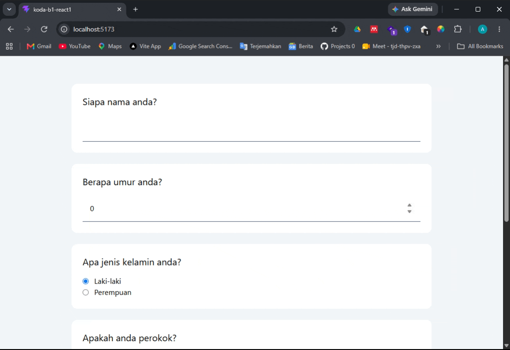

# React 1
on this repo i learn about react from scratch, and to understand about 
component in react, so i made the survery form for smokers with just basic html, no style no js yet

## Update
i update this repo to have simpel single page application routing (SPA) using react router dom, and then i also add result page
which will render the data was saved on form page inside local storage
### New result

### Result

